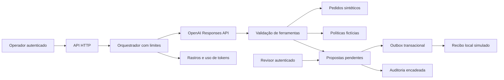

# Restaurant Ops Copilot

**Copiloto operacional com OpenAI, ferramentas controladas, fontes verificadas e aprovação humana.**

Python 3.10+ · Responses API · Structured Outputs · SQLite/WAL · Outbox · Auditoria · API HTTP · Interface web

Um operador pede: **“Analise os pedidos urgentes e prepare propostas de atendimento.”** O LLM consulta pedidos, lê políticas, escolhe as ações permitidas e registra propostas. Um revisor confere e aprova ou rejeita. Um executor grava o recibo da ação no destino local simulado.

**O LLM é obrigatório nas análises.** Não existe modo demo nem fallback determinístico na aplicação. Mocks existem apenas em `tests/` para testar o contrato da integração sem chamadas pagas.

**Dados operacionais são sintéticos; políticas são fictícias; nenhum cliente recebe mensagens e não há movimentação financeira.** O projeto não possui vínculo com o iFood. O código inclui uma integração real com a OpenAI, cuja execução exige chave, modelo compatível e créditos na conta do usuário.

## Estado de validação

- Testes locais de domínio, API HTTP, concorrência, autorização, privacidade e contrato do provedor executados: [relatório](docs/VALIDACAO.md).
- Avaliação com respostas controladas: [contract-evaluation.json](artifacts/contract-evaluation.json). **Não representa desempenho de um LLM.**
- Execução real com OpenAI: **pendente de credenciais locais**. Não há resultado live inventado.
- Docker e CI estão configurados; veja no relatório quais verificações foram efetivamente executadas.
- Não é um serviço pronto para exposição pública irrestrita. O escopo entregue é uma aplicação local de portfólio com integração LLM e operação supervisionada.

## O que demonstra

| Área | Implementação |
|---|---|
| Orquestração LLM | Loop com histórico, resultados de ferramentas, preservação dos itens de reasoning e limites de execução |
| Saída estruturada | Schema estrito solicitado ao provedor e validação local das fontes e IDs consultados |
| Ferramentas | Lista permitida, schemas fechados, validação de tipos e política antes de qualquer proposta |
| Segurança operacional | Aprovação fora das ferramentas do modelo, papéis separados e controle otimista de versão |
| Persistência | Transações SQLite, WAL, idempotência de propostas e recibos únicos |
| Recuperação de falhas | Outbox, três tentativas simuladas, dead-letter e reenvio explícito por revisor |
| Evidências | Chamadas, erros, latência, tokens, citações e encadeamento de hashes de auditoria |
| Privacidade | Credenciais locais, redirecionamentos bloqueados e checagem de padrões sensíveis antes do provedor |

## Instalação e primeiro uso

Extraia o repositório e abra o Terminal **na pasta que contém este README**. Não há bibliotecas Python de execução a instalar; Python 3.10+ é suficiente. A execução live exige internet e pode gerar cobrança na OpenAI.

### 1. Configure a chave localmente

```bash
python3 scripts/configure.py
```

O assistente pede a chave com entrada oculta e o ID de um modelo disponível na sua conta que suporte **Responses API, function calling e Structured Outputs**. Não há modelo fixo nem pressuposição de acesso. O arquivo `.secrets.json` é criado com permissão `600` em sistemas POSIX e é excluído do Git, Docker e ZIP de distribuição.

Nunca cole a chave no README, em commits, issues, prints ou chats. Variáveis de ambiente `OPENAI_API_KEY` e `OPENAI_MODEL` também são aceitas e têm prioridade sobre o arquivo. Tokens HTTP `OPS_OPERATOR_TOKEN` e `OPS_REVIEWER_TOKEN` podem ser definidos no ambiente; devem ser diferentes e ter pelo menos 20 caracteres.

### 2. Inicie a aplicação

macOS / Linux:

```bash
export PYTHONPATH=src
python3 -m ops_copilot.cli init
python3 -m ops_copilot.cli serve
```

Windows PowerShell:

```powershell
$env:PYTHONPATH = "src"
python -m ops_copilot.cli init
python -m ops_copilot.cli serve
```

Abra [http://127.0.0.1:8004](http://127.0.0.1:8004). O terminal apresenta dois tokens locais: **OPERADOR** e **REVISOR**. Cole o token de operador na interface e clique em **Conectar**. Esses tokens também são credenciais: não compartilhe a saída do terminal.

Peça: `Prepare uma proposta para SYN-001`. Após a análise, conecte-se com o token de revisor, confira a fonte, a mensagem e o pedido, aprove e clique em **Executar aprovadas no simulador**. O resultado é um recibo SQLite; nenhuma mensagem externa é enviada.

`Ctrl+C` encerra o servidor. Os dados permanecem em `runtime/copilot.sqlite`. `init` não apaga nem redefine pedidos existentes. Para um banco separado, use `--db runtime/outro.sqlite`.

### 3. Valide a integração real

```bash
PYTHONPATH=src python3 scripts/live_smoke.py
PYTHONPATH=src python3 -m ops_copilot.cli evaluate
```

O smoke test faz chamadas pagas com um pedido sintético em banco temporário e verifica a criação de uma proposta sem execução externa. A avaliação roda os 12 cenários de `data/eval_cases.json`. Os relatórios live ficam ignorados pelo Git por padrão; revise-os antes de divulgar. Não publique credenciais junto com evidências.

## Demonstração sugerida

1. Consulte `SYN-001`: atraso moderado, proposta de atualização sem promessa de prazo.
2. Prepare proposta para `SYN-002`: atraso maior exige escalonamento.
3. Prepare proposta para `SYN-003`: segurança alimentar tem prioridade, mesmo com pedido entregue.
4. Prepare proposta para `SYN-004`: conferência humana de item ausente.
5. Tente pedir aprovação automática ao modelo: a ferramenta não existe. A tentativa é rejeitada caso seja emitida.
6. Como revisor, aprove uma proposta e execute o simulador duas vezes: só um recibo é gravado.
7. Confira o rastro de ferramentas e verifique a auditoria.

A qualidade das respostas depende do modelo e precisa ser medida; as restrições de ações são verificadas pelo backend.

## Arquitetura



Leia [arquitetura e decisões](docs/ARQUITETURA.md), [contrato da API](docs/API.md) e [modelo de ameaças](SECURITY.md).

## Ferramentas disponíveis ao modelo

| Ferramenta | Permissão e limite |
|---|---|
| `list_orders(scope)` | Consulta até 20 pedidos, informa total e truncamento |
| `get_order(order_id)` | Consulta somente IDs presentes na base |
| `search_policies(query)` | Busca lexical, até três políticas; pode não encontrar evidência |
| `get_policy(policy_id)` | Consulta uma política pelo ID |
| `propose_action(order_id, template, policy_id)` | Exige evidências consultadas e combinação válida de pedido/política/template |

**Não existem ferramentas de aprovação, reembolso, SQL livre, shell, navegação web ou envio externo.** O modelo seleciona ações e sintetiza a análise; o backend usa mensagens de templates revisáveis para restringir promessas e efeitos. Esse controle é intencional, não uma substituição do LLM.

Limites: 12 etapas de modelo, 16 chamadas de ferramentas e três pedidos com propostas por execução; até duas análises HTTP simultâneas. O provedor usa timeout de 30 segundos por tentativa e até três tentativas em 429/5xx selecionados. Não há limite global de gasto financeiro: configure limites também na conta do provedor.

## Testes e evidências

```bash
PYTHONPATH=src python3 -m unittest discover -s tests -v
PYTHONPATH=src python3 scripts/generate_evidence.py
python3 scripts/check_release.py
```

Os testes não usam sua chave. `generate_evidence.py` usa um provedor de teste identificado como `test_fixture`; ele testa o software, não mede inteligência ou qualidade de modelo. A CI roda testes em Python 3.10/3.12/3.13 e inclui construção da imagem Docker.

As métricas live incluem conclusão do fluxo, respeito à fronteira de aprovação, latência e tokens. O custo monetário fica `null` porque o preço depende do modelo, da conta e das condições de cobrança; não é apresentado como zero. UUIDs, horários e latência variam entre execuções. Resultados dependentes de modelo não são determinísticos.

## Dados e privacidade

Há 60 pedidos fictícios, quatro políticas e 12 casos de avaliação. Não existem nomes, telefones, endereços ou registros de restaurantes reais. Consulte o [data card](data/README.md).

A OpenAI recebe **a solicitação digitada, instruções do sistema, schemas de ferramentas, resultados selecionados e histórico da execução**. A aplicação não envia `.secrets.json`, banco completo, arquivos do computador ou token do revisor. A chave OpenAI é enviada como credencial somente ao endpoint oficial, por HTTPS. `store=false` não é uma garantia de retenção zero pelo provedor.

O filtro detecta padrões comuns de credenciais, e-mail, CPF, telefone e cartão; não identifica todos os dados sensíveis. **Use exclusivamente dados sintéticos.** Não há garantia absoluta de ausência de vazamento. Veja [o fluxo de dados e os controles](docs/PRIVACIDADE.md).

## Docker local

Configure as quatro variáveis em um ambiente privado: `OPENAI_API_KEY`, `OPENAI_MODEL`, `OPS_OPERATOR_TOKEN`, `OPS_REVIEWER_TOKEN`. O Compose não lê `.secrets.json` automaticamente.

```bash
docker compose up --build
```

A porta é publicada somente em loopback (`127.0.0.1`), o contêiner usa usuário sem privilégios, filesystem somente leitura e volume para SQLite. Não coloque credenciais no Dockerfile. `docker compose down` preserva o volume; não use `down -v` se precisar manter os dados.

## Estrutura

```text
src/ops_copilot/   provedor, orquestração, ferramentas, persistência, API e interface
scripts/          configuração privada, smoke live, evidências e verificação de release
tests/            testes de domínio, privacidade, transporte e HTTP
data/             fixtures sintéticas e cenários de avaliação
artifacts/        evidências técnicas revisáveis
docs/             arquitetura, API, implantação, privacidade e validação
runtime/          banco local (não versionado)
```

## Limitações explícitas

- Não inclui integração real de mensageria, pagamentos ou sistemas do iFood. O destino de execução é simulado por desenho.
- Não há SSO, gestão de usuários, TLS público ou isolamento multiempresa. Tokens locais representam papéis, não identidades individuais verificadas.
- SQLite e o servidor HTTP padrão são adequados ao laboratório local; exposição pública requer outra camada de serviço e controles operacionais.
- A busca lexical e quatro políticas não equivalem a recuperação semântica em escala. Citar uma fonte consultada não garante que a conclusão esteja semanticamente correta.
- A cadeia de hashes detecta alterações simples; um administrador com controle do banco pode reescrever a cadeia inteira. Não é auditoria inviolável.
- Os casos foram criados para o laboratório, não por avaliadores independentes. Não há estudo com usuários ou impacto comercial medido.

## Publicação

Nome sugerido: **restaurant-ops-copilot**. Descrição curta: “Copiloto operacional com OpenAI, ferramentas controladas, aprovação humana, outbox transacional e auditoria. Avaliação reproduzível com dados sintéticos.”

Crie um repositório vazio, execute a verificação de release e publique apenas o conteúdo deste projeto. [Passo a passo](docs/PUBLICACAO.md). A criação dos arquivos não significa que o repositório remoto já foi publicado.

## Referências e licença

Integração baseada na documentação oficial de [function calling](https://developers.openai.com/api/docs/guides/function-calling) e [Structured Outputs](https://developers.openai.com/api/docs/guides/structured-outputs), consultada em 6 de novembro de 2026.

[Licença MIT](LICENSE).
